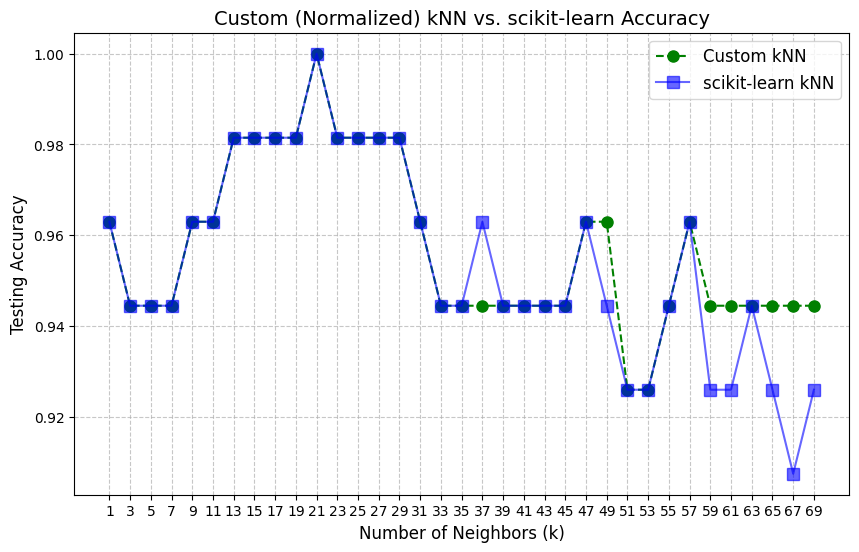
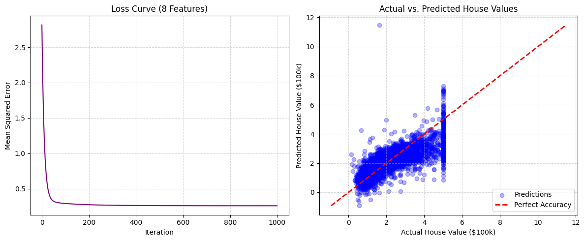

# Project 0 — Entrance Challenge: kNN & Gradient Descent

The entrance challenge for the Rahnema College ML Bootcamp. It has two tasks. Each one builds a classic algorithm **from scratch in NumPy** and then checks it against scikit-learn.

| Notebook | Task | Dataset |
|---|---|---|
| [`task_A_kNN_classifier.ipynb`](task_A_kNN_classifier.ipynb) | k-Nearest Neighbors classifier | Wine (`sklearn.datasets.load_wine`) |
| [`task_B_gradient_descent_regression.ipynb`](task_B_gradient_descent_regression.ipynb) | Linear regression trained with batch gradient descent | California Housing (`sklearn.datasets.fetch_california_housing`) |

---

## Task A — kNN Classifier

**What was done**
- Custom `predict_knn` using Euclidean distance (the Minkowski distance with p = 2) and a majority vote.
- 70/30 stratified train/test split (`random_state=42`).
- Accuracy measured for every odd `k` from 1 to 69. Odd values avoid ties in the vote.
- **Z-score standardization**: the 13 Wine features are on very different scales, so raw Euclidean distance is dominated by a few features. Standardizing with the training mean/std noticeably improves accuracy.
- Sanity check against `sklearn.neighbors.KNeighborsClassifier`. Both implementations give matching accuracy curves.

<p align="center"></p>

## Task B — Gradient Descent Linear Regression

**What was done**
- A `LinearRegressionGD` class with the hypothesis $h_\theta(x)=\theta_0+\theta^\top x$, the MSE cost $J(\theta)=\frac{1}{2m}\sum (h_\theta(x^{(i)})-y^{(i)})^2$ and batch gradient-descent updates.
- First a **single-feature** model (median income), then the full **8-feature** model.
- Overflow appeared on the 8-feature model because of feature scale differences. Z-score scaling fixed it.
- Loss curves, a Predicted-vs-Actual plot, and a **learning-rate sweep** (bonus).

**Results (test MSE)**

| Model | MSE |
|---|---|
| Custom GD — 1 feature (MedInc) | 0.7282 |
| Custom GD — 8 features | **0.5562** |
| scikit-learn `LinearRegression` — 8 features | 0.5559 |

The custom gradient-descent model nearly matches the closed-form scikit-learn solution.

<p align="center"></p>

---

## How to run

```bash
pip install numpy scikit-learn matplotlib jupyter
jupyter notebook
```

Both datasets are downloaded automatically by scikit-learn.

**Concepts:** kNN, distance metrics, feature scaling, linear regression, gradient descent, learning rate, MSE.
