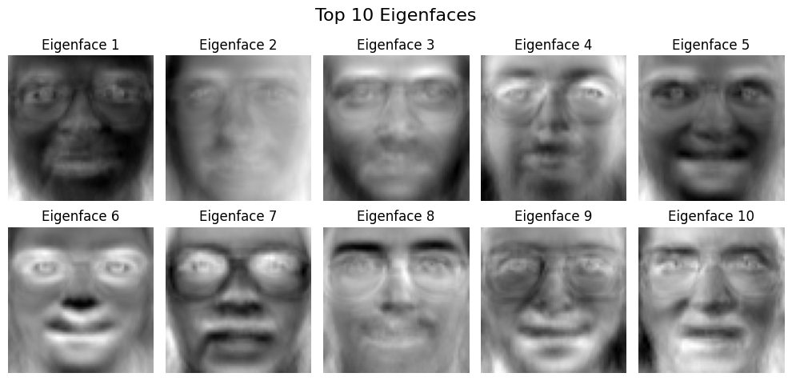
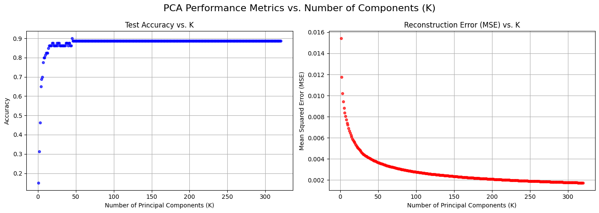
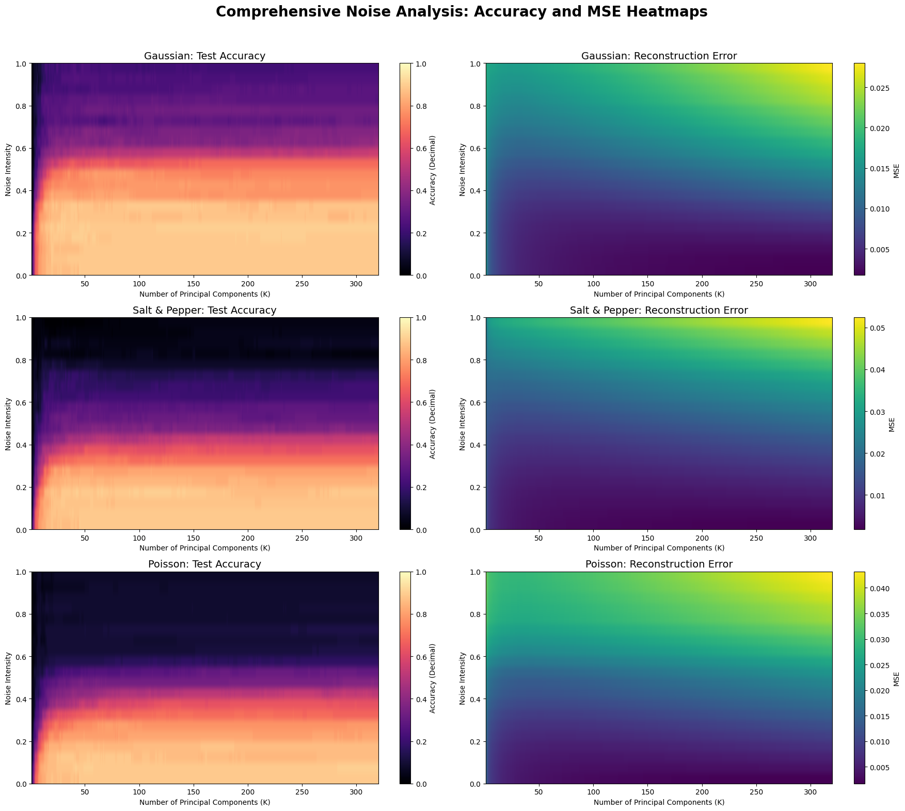
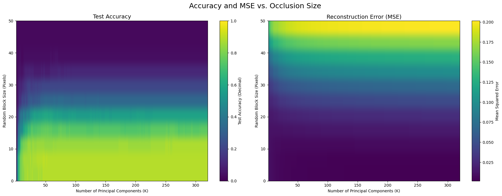

# Project 1 — PCA Face Identification (Eigenfaces)

**Team 5 — Pufa:** Sara, Mohammad Javad, Hemo, Mahdi

A face identification system built **from scratch with NumPy**, using Principal Component Analysis (eigenfaces) and a nearest-neighbor classifier on the **Olivetti Faces** dataset. As the team's special task, we also stress-tested the model's **robustness to noise and occlusion**.

| File | Description |
|---|---|
| [`pca_face_identification.ipynb`](pca_face_identification.ipynb) | Full implementation, experiments and analysis |
| [`report.pdf`](report.pdf) | Short written report |
| [`requirements.txt`](requirements.txt) | Python dependencies |
| [`images/`](images) | Key figures |

---

## Pipeline

**Phase 1: Data preparation**
- Olivetti: 40 people × 10 images, 64×64 grayscale (4096 features).
- Per person: first 8 images → train (320 images), last 2 → test (80 images).
- Mean-face centering and a per-pixel variance map.

**Phase 2: Learning the subspace**
- Covariance matrix $S=\frac{1}{N-1}X_c^\top X_c$ and eigendecomposition (`np.linalg.eigh`), sorted by eigenvalue.
- Explained/cumulative variance, an orthogonality check of the eigenvectors, and visualized **eigenfaces**.
- Reconstruction $X_{rec}=(X_c U_k)U_k^\top+\mu$ for $k\in\{10,50,150\}$.

<p align="center"></p>

**Phase 3: Evaluation**
- Project train and test images into the k-dimensional space, then classify with **1-Nearest-Neighbor** (Euclidean).
- Accuracy and reconstruction MSE over all $k=1\ldots320$, plus failure-case and distance-gap analysis.
- **SVD comparison**: SVD of $X_c$ gives the same subspace and reconstructions (difference ≈ 6e-7).

| Metric (k = 50) | Value |
|---|---|
| Test accuracy | **88.75 %** |
| Reconstruction MSE | 0.0037 |

<p align="center"></p>

---

## Special task: robustness to noise and occlusion

Noise and masks were applied **only to the test set**. The model was learned on clean data.

- **Noise:** Gaussian, Salt & Pepper, and Poisson (shot) noise at increasing intensities.
- **Fixed masks:** "sunglasses" (eyes), "medical mask" (mouth/chin), and half-face.
- **Random sliding block:** square black occlusions from 0 to 50 px, swept against $k$.

<p align="center"></p>
<p align="center"></p>

**Key findings**
- Accuracy plateaus around **k ≈ 50**. The number of useful components is bounded by the 320 training samples.
- PCA is quite robust to **mild noise** (88.75 % → 87.5–88.75 % at intensity 0.1).
- PCA is a *global* method, so it **fails badly under occlusion**. Black pixels become the "negative ghost" of the mean face after centering, which corrupts the projection weights. Higher $k$ makes this **worse**, because the model "hallucinates" detailed facial structure where the mask is.

---

## How to run

```bash
pip install -r requirements.txt jupyter
jupyter notebook pca_face_identification.ipynb
```

The Olivetti dataset is downloaded automatically by `sklearn.datasets.fetch_olivetti_faces`.

**Concepts:** PCA, eigendecomposition, SVD, eigenfaces, dimensionality reduction, nearest neighbor, image reconstruction, robustness analysis.
