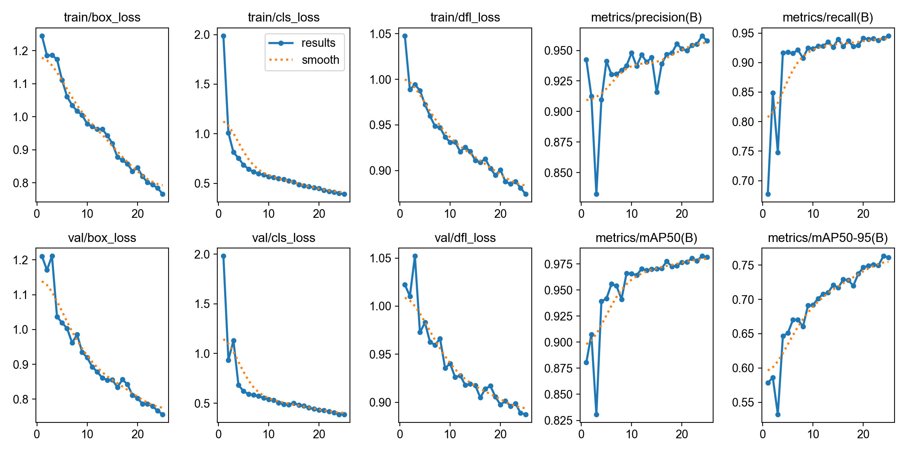
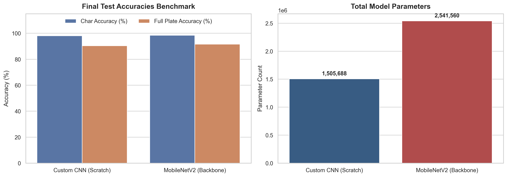
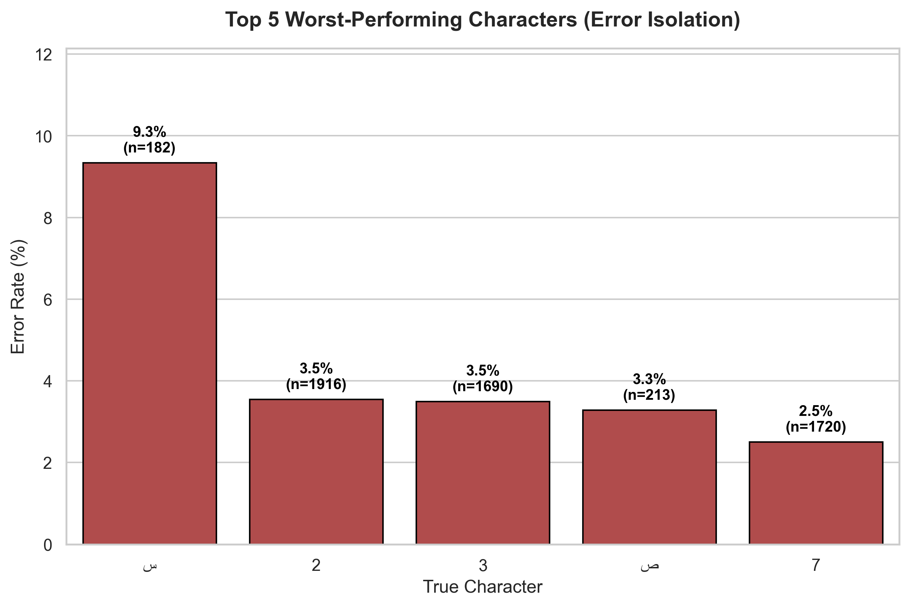

# Project 2 — Iranian License Plate Detection & Recognition (LPDR)

**Team 5 — Pufa:** Hemo, Mohammad Javad, Sara, Mahdi

An end-to-end, two-stage pipeline for Iranian license plates:
1. **Detection:** YOLOv8-nano finds the plate in a vehicle image.
2. **Recognition:** a PyTorch CNN reads the cropped plate as **8 characters** (7 digits and 1 Persian letter, 31 classes in total).

| File / folder | Description |
|---|---|
| [`lpdr_pipeline.ipynb`](lpdr_pipeline.ipynb) | Main notebook: data split, YOLO training, both recognition models, end-to-end pipeline, analysis |
| [`technical_report.ipynb`](technical_report.ipynb) | Technical report with all results and figures |
| [`weights/`](weights) | Trained weights: YOLO detector, Custom CNN, MobileNetV2, and training histories |
| [`output_images/`](output_images) | Figures used in the report |
| [`runs/detect/lpd_yolo/`](runs/detect/lpd_yolo) | Ultralytics training log, curves and validation batches |
| [`data.yaml`](data.yaml) | YOLO dataset config (single class: `license_plate`) |
| `plate_labels.csv`, `valid_samples.csv` | Plate-text labels for the recognition dataset |

---

## Stage 1 — Plate detection (YOLOv8n)

- 5,829 labeled plate instances, with an 80/20 train/val split.
- Trained for 25 epochs. `batch=16, workers=2` fixed dataloader contention on the local GPU.

| Precision | Recall | mAP@0.5 | mAP@0.5:0.95 |
|---|---|---|---|
| 96.0 % | 94.0 % | **98.3 %** | 76.3 % |

<p align="center"></p>

## Stage 2 — Plate recognition (Custom CNN vs. MobileNetV2)

- About 23.5k labeled plate crops → 18,815 train / 2,351 val / 2,353 test.
- 8 parallel classification heads, one per character position.
- **Custom CNN (from scratch).** The first design had 14 M parameters and overfit. A heavily reduced version underfit. The final design added BatchNorm, LayerNorm, Dropout (0.3) and residual connections, then tuned the pooling, and ended at about 1.5 M parameters.
- **MobileNetV2:** a pre-trained backbone, fine-tuned.
- A training engine that tracks gradient norms and the generalization gap.

| Model | Params | Char acc. | Full-plate acc. | Latency |
|---|---|---|---|---|
| Custom CNN (scratch) | 1,505,688 | 98.05 % | 90.35 % | 2.79 ms/plate |
| MobileNetV2 (fine-tuned) | 2,541,560 | **98.46 %** | **91.54 %** | **2.36 ms/plate** |

<p align="center"></p>

## Analysis highlights

- **Deployment:** MobileNetV2 is both more accurate *and* faster, thanks to depthwise-separable convolutions.
- **Camera limits:** full-plate accuracy drops sharply for small plates. A plate area of at least ~12,000 px is needed to stay above 90 %.
- **Failure modes:** most errors are in the single **Persian letter** slot (e.g. `س` ↔ `ص`) and in visually similar digits (`2` ↔ `3`). Causes are motion blur, perspective, and far fewer training examples for letters than for digits.

<p align="center"></p>

---

## How to run

```bash
pip install ultralytics torch torchvision opencv-python pandas matplotlib seaborn scikit-learn jupyter
```

> **Dataset not included.** The raw images (≈ 4 GB), YOLO labels, and generated crops are left out of this repo because of their size. To retrain, place the data as `images/{train,val}` and `labels/{train,val}` next to `data.yaml`. The trained weights in `weights/` can be used directly for inference.

**Concepts:** object detection, YOLO, CNN design, transfer learning, multi-head classification, regularization, gradient monitoring, latency benchmarking, error analysis.
