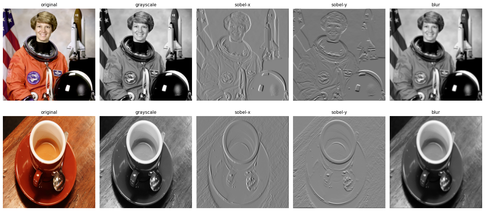
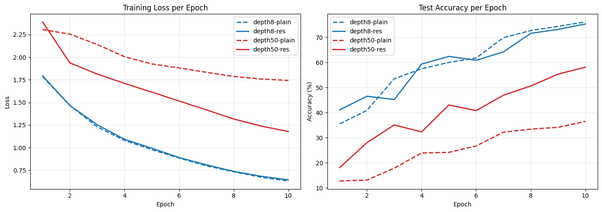
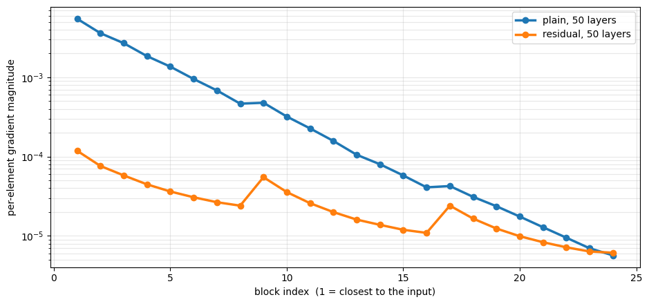
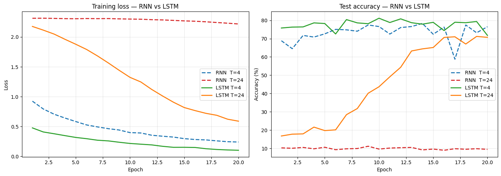
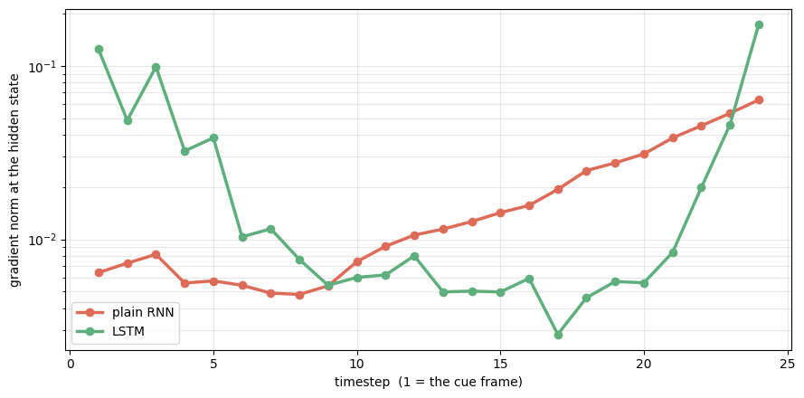

# Project 3 — CNN, RNN & LSTM: Convolutions, Depth and Memory

**Author:** M. Mahdi Mostafaei (Team 5 — Pufa)

This project has three experiments that cover how convolutions work, why **residual connections** make deep networks trainable, and why **LSTMs** remember things that vanilla RNNs forget. Everything is in [`cnn_rnn_lstm.ipynb`](cnn_rnn_lstm.ipynb), run on an RTX 3050 (PyTorch 2.10 + CUDA).

---

## Part 1 — Convolution & pooling from scratch (NumPy)

- `MyConv`: a 2D convolution with stride and padding, with forward and backward passes.
- `MyMaxPool`: max pooling with exact single-route tie-breaking, with forward and backward passes.
- Verified by **numerical gradient checking** (relative errors ≈ 1e-8 to 1e-12).
- Hand-designed 3×3 kernels (e.g. grayscale conversion) applied to sample images.

<p align="center"></p>

## Part 2 — Depth experiment: plain vs. residual CNN (CIFAR-10)

The same architecture is built with and without skip connections, at **8 layers** and **50 layers**. Each run trains for 10 epochs on 20k CIFAR-10 images with SGD + cosine LR.

| Run | Final train loss | Test acc. |
|---|---|---|
| 8-layer plain | 0.631 | 76.11 % |
| 8-layer residual | 0.644 | 75.30 % |
| 50-layer plain | 1.742 | 36.50 % |
| 50-layer residual | 1.178 | **58.09 %** |

- At 8 layers, skip connections make no real difference.
- At 50 layers, the **plain network degrades** badly. The residual network keeps learning.
- Block-wise gradient norms explain why. Across depth, gradients spread over **~3 orders of magnitude in the plain net**, against **~1.3 in the residual net**.

<p align="center"></p>
<p align="center"></p>

## Part 3 — Memory experiment: RNN vs. LSTM (sequential MNIST)

- **Task:** the model sees a sequence of *T* MNIST digits and must output `(first digit + last digit) mod 10`. To solve it, the model has to remember the first frame for the whole sequence.
- Hand-written `MyRNNCell` (orthogonal init) and `MyLSTMCell` (forget-gate bias = 3) on top of a small CNN encoder. The encoder is pre-trained on single frames, then training runs in two phases: encoder frozen, then fine-tuned.

| Run | Final loss | Test acc. |
|---|---|---|
| RNN, T = 4 | 0.241 | 76.50 % |
| RNN, T = 24 | 2.218 | 9.50 % (chance) |
| LSTM, T = 4 | 0.103 | 71.75 % |
| LSTM, T = 24 | 0.590 | **70.70 %** |

- The RNN **forgets** with long sequences. The LSTM keeps nearly the same accuracy at T = 24.
- Per-timestep gradients: from t = 24 back to t = 1 the gradient shrinks **~9.9×** in the RNN and only **~1.4×** in the LSTM.

<p align="center"></p>
<p align="center"></p>

---

## How to run

```bash
pip install torch torchvision numpy matplotlib pillow scikit-image jupyter
jupyter notebook cnn_rnn_lstm.ipynb
```

CIFAR-10 and MNIST are downloaded automatically into `./data`. A CUDA GPU is recommended.

**Concepts:** convolution and pooling backprop, gradient checking, residual networks, vanishing gradients, degradation problem, RNN, LSTM, long-term dependencies.
