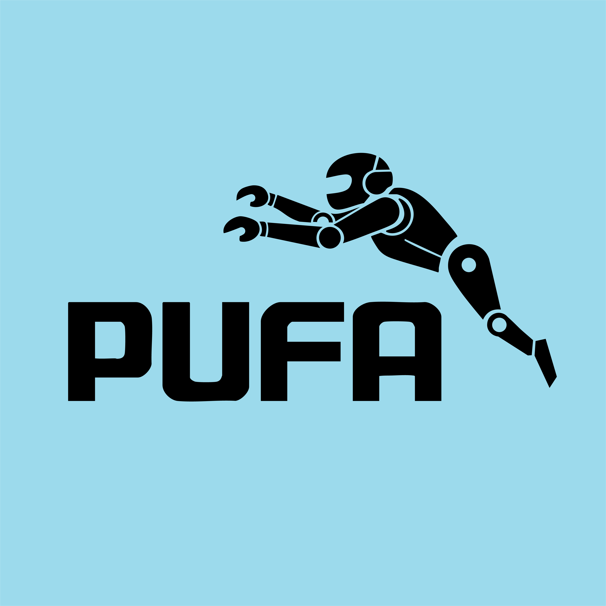

<p align="center"></p>

# Rahnema ML Bootcamp

My projects from the **Rahnema College Machine Learning Bootcamp**. They go from classic algorithms implemented from scratch to end-to-end deep-learning systems. Team projects were done with **Team 5 — Pufa**.

| # | Project | Topics | Highlights |
|---|---|---|---|
| 0 | [Entrance Challenge: kNN & Gradient Descent](00-Entrance-Challenge-kNN-and-Gradient-Descent) | kNN, linear regression, gradient descent, feature scaling | From-scratch NumPy models matching scikit-learn (test MSE 0.556 vs 0.556) |
| 1 | [PCA Face Identification (Eigenfaces)](01-PCA-Eigenfaces-Face-Recognition) | PCA, SVD, nearest neighbor, robustness | 88.75 % accuracy on Olivetti; noise and occlusion stress tests |
| 2 | [License Plate Detection & Recognition](02-License-Plate-Detection-and-Recognition) | YOLOv8, CNNs, transfer learning | 98.3 % mAP@0.5 detection; 91.5 % full-plate recognition |
| 3 | [CNN, RNN & LSTM: Depth and Memory](03-CNN-Depth-and-RNN-LSTM-Memory) | Conv backprop, ResNets, RNN vs. LSTM | Shows the degradation problem and vanishing gradients |

---

## Project summaries

### 0 · Entrance Challenge — kNN & Gradient Descent
The bootcamp's entrance challenge. A **kNN classifier** on the Wine dataset and a **linear regression trained with gradient descent** on California Housing, both written in NumPy. It shows why feature scaling matters for distance-based models and for gradient-descent convergence. Both models are validated against scikit-learn.

### 1 · PCA Face Identification
An **eigenfaces** face-recognition system on the Olivetti dataset: covariance → eigendecomposition → projection → 1-NN classification. It covers image reconstruction for different numbers of components and confirms that PCA and SVD give the same result. As the team's special task, we measured how the model holds up under **Gaussian / salt-and-pepper / Poisson noise** and **occlusion masks** (sunglasses, medical mask, random blocks). PCA tolerates noise well but fails under occlusion.

### 2 · License Plate Detection & Recognition
A two-stage pipeline for **Iranian license plates**. **YOLOv8-nano** locates the plate (98.3 % mAP@0.5), and a CNN reads its 8 characters (7 digits and 1 Persian letter). We compared a **custom CNN built from scratch** (90.4 % full-plate accuracy) with a **fine-tuned MobileNetV2** (91.5 %, and faster). The project includes latency benchmarking, a camera-resolution analysis, and character-level error analysis.

### 3 · CNN, RNN & LSTM
Three experiments. (1) **Convolution and max-pooling written from scratch** with gradient checking. (2) **Plain vs. residual CNNs** at 8 and 50 layers on CIFAR-10: the residual net trains at depth and the plain one degrades (58 % vs. 36.5 %). (3) **RNN vs. LSTM** on a long-memory sequential-MNIST task: the RNN drops to chance at T = 24 while the LSTM keeps about 71 %. Gradient-norm measurements explain both results.

---

## Repository structure

```
.
├── 00-Entrance-Challenge-kNN-and-Gradient-Descent/
├── 01-PCA-Eigenfaces-Face-Recognition/
├── 02-License-Plate-Detection-and-Recognition/
├── 03-CNN-Depth-and-RNN-LSTM-Memory/
└── assets/
```

Each folder has its own README with details, results, and how to run it.

## Tech stack

Python · NumPy · scikit-learn · PyTorch · torchvision · Ultralytics YOLO · Matplotlib · Jupyter

> Large datasets (e.g. the ~4 GB license-plate images, CIFAR-10, MNIST) are not included. Public datasets download automatically inside the notebooks.
